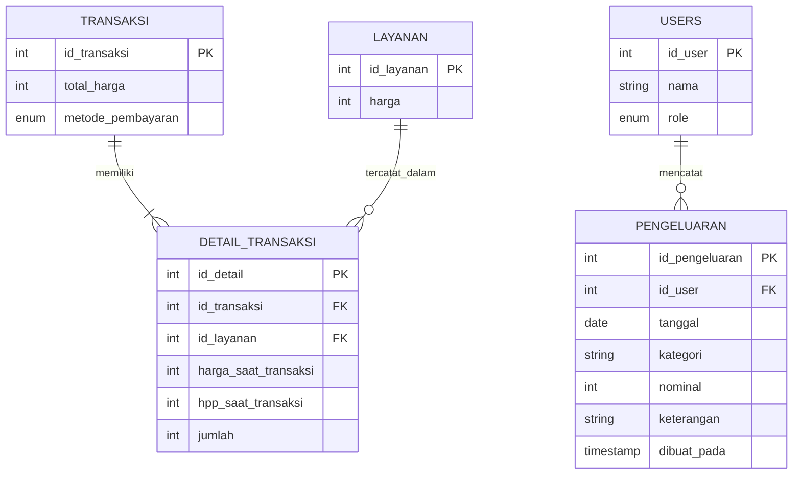

# ERD — Transaksi Multi-Layanan dan Pengeluaran

## Catatan Pengeluaran

- `id_pengeluaran` adalah primary key dan bertambah otomatis.
- `id_user` adalah foreign key ke `users.id_user`, yaitu owner yang mencatat pengeluaran melalui API.
- `tanggal` digunakan untuk menyaring daftar dan menghitung total pengeluaran harian.
- `nominal` wajib lebih dari nol.
- `keterangan` bersifat opsional.
