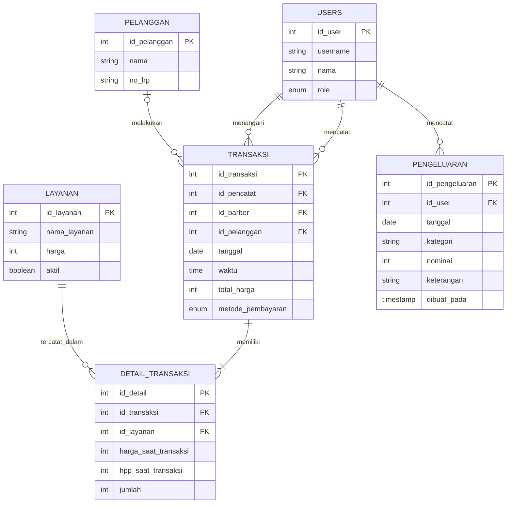

# ERD — Transaksi Multi-Layanan, Pelanggan, dan Pengeluaran

## Relasi Antar Tabel

- `USERS.id_user` menjadi referensi untuk `TRANSAKSI.id_pencatat`, yaitu pengguna yang mencatat transaksi.
- `USERS.id_user` menjadi referensi untuk `TRANSAKSI.id_barber`, yaitu barber yang menangani transaksi.
- `PELANGGAN.id_pelanggan` menjadi referensi untuk `TRANSAKSI.id_pelanggan`.
- `TRANSAKSI.id_transaksi` menjadi referensi untuk `DETAIL_TRANSAKSI.id_transaksi`.
- `LAYANAN.id_layanan` menjadi referensi untuk `DETAIL_TRANSAKSI.id_layanan`.
- `USERS.id_user` menjadi referensi untuk `PENGELUARAN.id_user`, yaitu owner yang mencatat pengeluaran.

## Catatan Pelanggan

- `id_pelanggan` adalah primary key tabel `pelanggan`.
- Data pelanggan mencakup nama dan nomor telepon.
- Nama pelanggan wajib diisi saat mencatat transaksi.
- Jika pelanggan dipilih dari saran nama yang tersedia, transaksi menggunakan `id_pelanggan` milik pelanggan tersebut.
- Jika pelanggan baru dicatat, data pelanggan baru disimpan dan dihubungkan dengan transaksi.
- Pemilihan pelanggan lama tidak boleh membuat data pelanggan duplikat.
- Kontrak transaksi lama memperbolehkan `id_pelanggan` bernilai `null`. Aturan ini perlu diperiksa kembali terhadap implementasi validasi terbaru yang mewajibkan nama pelanggan.

## Catatan Detail Transaksi

- `id_detail` adalah primary key tabel `detail_transaksi`.
- `id_transaksi` menghubungkan detail dengan transaksi.
- `id_layanan` menghubungkan detail dengan layanan.
- `harga_saat_transaksi` menyimpan harga layanan pada saat transaksi dibuat.
- `hpp_saat_transaksi` menyimpan HPP layanan pada saat transaksi dibuat.
- `jumlah` menyimpan jumlah layanan yang dicatat.
- Data transaksi dan detail layanan disimpan dalam satu transaksi database.

## Catatan Layanan

- `id_layanan` adalah primary key tabel `layanan`.
- `nama_layanan` menyimpan nama layanan.
- `harga` menjadi dasar perhitungan harga transaksi.
- `hpp` menyimpan harga pokok produksi atau biaya layanan.
- `aktif` menunjukkan status layanan: `1` untuk aktif dan `0` untuk nonaktif.
- `icon_layanan` menyimpan path relatif file ikon layanan dan boleh bernilai `NULL` jika layanan tidak memiliki ikon.
- API GET layanan menampilkan layanan aktif maupun nonaktif agar statusnya dapat dikelola dari halaman layanan.
- API POST dapat menambahkan layanan dengan ikon opsional.
- API PUT dapat mengedit layanan aktif maupun nonaktif. Jika ikon baru tidak diunggah, ikon lama tetap digunakan.
- Jika ikon diganti, file ikon lama dihapus setelah pembaruan database berhasil.
- Jika layanan dihapus permanen melalui API DELETE, file ikonnya ikut dihapus.
- Ikon yang diterima adalah JPG/JPEG, PNG, atau WebP dengan ukuran maksimal 2 MB. File disimpan di folder `uploads/layanan/`.

**Verifikasi database:** pastikan kolom `hpp`, `aktif`, dan `icon_layanan` sesuai dengan skema database aktual. Kolom `icon_layanan` yang digunakan API bertipe `VARCHAR(255) NULL`.

## Catatan Pengeluaran

- `id_pengeluaran` adalah primary key dan bertambah otomatis.
- `id_user` adalah foreign key ke `users.id_user`, yaitu owner yang mencatat pengeluaran melalui API.
- `tanggal` digunakan untuk menyaring daftar dan menghitung total pengeluaran harian.
- `nominal` wajib lebih dari nol.
- `keterangan` bersifat opsional.
- `kategori` disimpan sebagai teks dengan panjang maksimal 100 karakter sesuai kontrak API.
- `tanggal` bertipe `DATE` dan digunakan sebagai tanggal operasional untuk filter serta rekap pengeluaran harian.
- Jika tanggal tidak dikirim melalui API, tanggal default ditentukan berdasarkan zona waktu `Asia/Jakarta` (WIB).

## Catatan Verifikasi ERD

Diagram ini disusun berdasarkan ERD dan kontrak API yang tersedia. Sebelum dijadikan ERD final, cocokkan nama tabel, kolom, primary key, foreign key, dan nullability dengan skema SQL serta migrasi yang digunakan oleh proyek.
