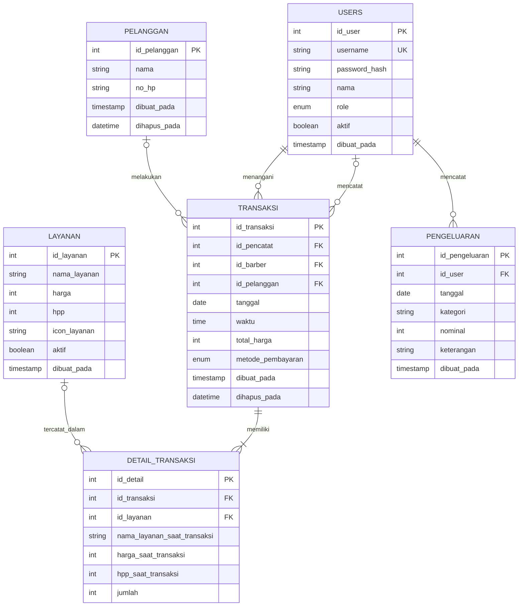

# ERD — Transaksi Multi-Layanan, Pelanggan, dan Pengeluaran

## Relasi Antar Tabel

- `USERS.id_user` menjadi referensi untuk `TRANSAKSI.id_pencatat`, yaitu pengguna yang mencatat transaksi. Boleh `NULL`; `ON DELETE SET NULL`.
- `USERS.id_user` menjadi referensi untuk `TRANSAKSI.id_barber`, yaitu barber yang menangani transaksi. Wajib; `ON DELETE RESTRICT`.
- `PELANGGAN.id_pelanggan` menjadi referensi untuk `TRANSAKSI.id_pelanggan`. Boleh `NULL`; `ON DELETE SET NULL`.
- `TRANSAKSI.id_transaksi` menjadi referensi untuk `DETAIL_TRANSAKSI.id_transaksi`. Wajib; `ON DELETE CASCADE`.
- `LAYANAN.id_layanan` menjadi referensi untuk `DETAIL_TRANSAKSI.id_layanan`. Boleh `NULL`; `ON DELETE SET NULL`, agar layanan dapat dihapus permanen tanpa merusak riwayat.
- `USERS.id_user` menjadi referensi untuk `PENGELUARAN.id_user`, yaitu owner yang mencatat pengeluaran. Wajib; `ON DELETE RESTRICT`.

## Catatan Pelanggan

- `id_pelanggan` adalah primary key tabel `pelanggan`.
- Data pelanggan mencakup `nama` dan `no_hp` (opsional). API transaksi hanya menyimpan nama; `no_hp` hanya terisi dari form kasir lama.
- Nama pelanggan wajib diisi saat mencatat transaksi (divalidasi di server).
- `dihapus_pada` menandai soft delete pelanggan. Pelanggan yang sudah dihapus tidak muncul di saran nama dan tidak bisa dipilih untuk transaksi baru, tetapi riwayat transaksi lama tetap menampilkan namanya.
- Jika pelanggan dipilih dari saran nama yang tersedia, transaksi menggunakan `id_pelanggan` milik pelanggan tersebut.
- Jika pelanggan baru dicatat, data pelanggan baru disimpan dan dihubungkan dengan transaksi.
- Pemilihan pelanggan lama tidak boleh membuat data pelanggan duplikat.
- `TRANSAKSI.id_pelanggan` tetap boleh `NULL` di database untuk transaksi lama yang dibuat sebelum fitur pelanggan. Transaksi baru selalu tertaut ke pelanggan karena nama wajib diisi.

## Catatan Transaksi

- `id_transaksi` adalah primary key dan bertambah otomatis.
- `metode_pembayaran` bernilai `cash`, `qris`, atau `transfer` (default `cash`).
- `tanggal` dan `waktu` diisi server dengan zona waktu `Asia/Jakarta` (WIB).
- `dihapus_pada` menandai soft delete oleh owner. Transaksi yang sudah dihapus tidak ditampilkan di daftar, detail, maupun rekap.

## Catatan Detail Transaksi

- `id_detail` adalah primary key tabel `detail_transaksi`.
- `id_transaksi` menghubungkan detail dengan transaksi.
- `id_layanan` menghubungkan detail dengan layanan dan boleh `NULL` bila layanan sudah dihapus permanen.
- `nama_layanan_saat_transaksi` menyimpan nama layanan pada saat transaksi dibuat.
- `harga_saat_transaksi` menyimpan harga layanan pada saat transaksi dibuat.
- `hpp_saat_transaksi` menyimpan HPP layanan pada saat transaksi dibuat.
- `jumlah` menyimpan jumlah layanan yang dicatat (1 sampai 100).
- Data transaksi dan detail layanan disimpan dalam satu transaksi database.

## Catatan Layanan

- `id_layanan` adalah primary key tabel `layanan`.
- `nama_layanan` menyimpan nama layanan.
- `harga` menjadi dasar perhitungan harga transaksi.
- `hpp` menyimpan harga pokok produksi atau biaya layanan; boleh `NULL`, dan jika diisi bernilai 0 atau lebih.
- `aktif` menunjukkan status layanan: `1` untuk aktif dan `0` untuk nonaktif.
- `icon_layanan` menyimpan path relatif file ikon layanan dan boleh bernilai `NULL` jika layanan tidak memiliki ikon.
- API GET layanan menampilkan layanan aktif maupun nonaktif agar statusnya dapat dikelola dari halaman layanan.
- API POST dapat menambahkan layanan dengan ikon opsional.
- API PUT dapat mengedit layanan aktif maupun nonaktif. Jika ikon baru tidak diunggah, ikon lama tetap digunakan.
- Jika ikon diganti, file ikon lama dihapus setelah pembaruan database berhasil.
- Jika layanan dihapus permanen melalui API DELETE, file ikonnya ikut dihapus dan `detail_transaksi.id_layanan` terkait menjadi `NULL`.
- Ikon yang diterima adalah JPG/JPEG, PNG, atau WebP dengan ukuran maksimal 2 MB. File disimpan di folder `uploads/layanan/`.

## Catatan Pengeluaran

- `id_pengeluaran` adalah primary key dan bertambah otomatis.
- `id_user` adalah foreign key ke `users.id_user`, yaitu owner yang mencatat pengeluaran melalui API.
- `tanggal` digunakan untuk menyaring daftar dan menghitung total pengeluaran harian.
- `nominal` wajib lebih dari nol.
- `keterangan` bersifat opsional.
- `kategori` disimpan sebagai teks dengan panjang maksimal 100 karakter sesuai kontrak API.
- Penghapusan pengeluaran bersifat permanen dan hanya untuk tanggal hari ini (WIB).
- `tanggal` bertipe `DATE` dan digunakan sebagai tanggal operasional untuk filter serta rekap pengeluaran harian.
- Jika tanggal tidak dikirim melalui API, tanggal default ditentukan berdasarkan zona waktu `Asia/Jakarta` (WIB).

## Catatan Verifikasi ERD

Diagram ini diselaraskan dengan skema `database/kataji_barber.sql` (nama tabel, kolom, primary key, foreign key, dan nullability) serta kode API di folder `api/`. Pemeriksaan dilakukan secara statis; skema belum dijalankan ulang pada server database.
